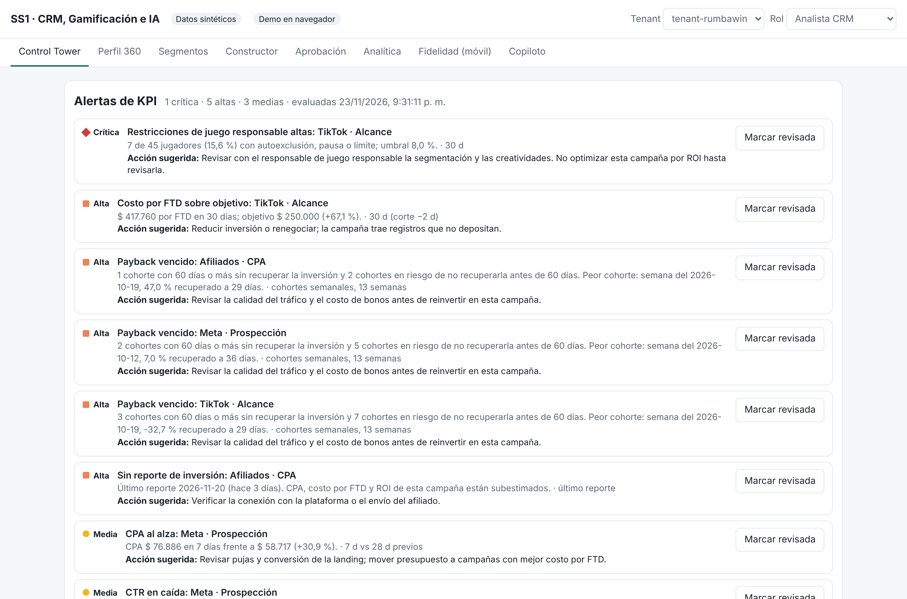
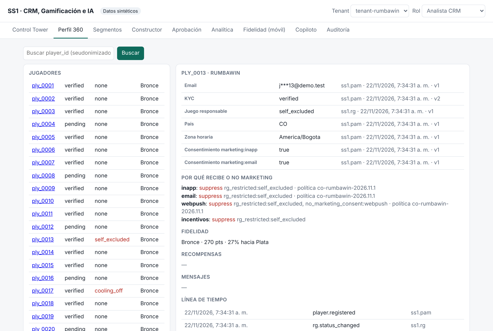
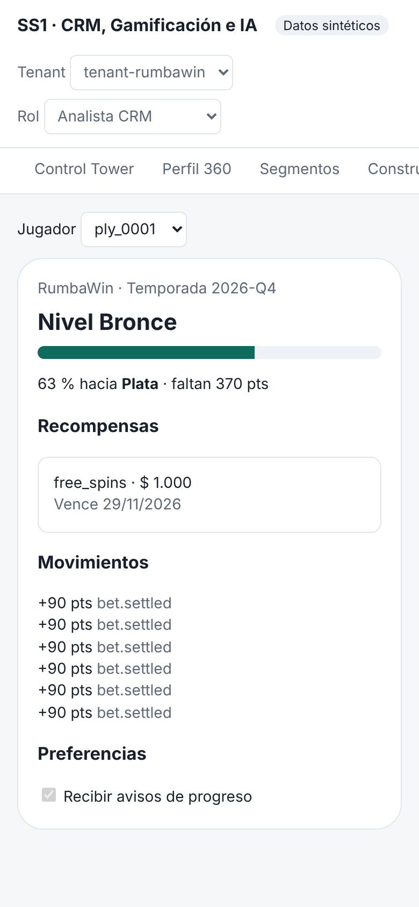

# SS1 · CRM, Gamificación e IA (MVP)

Módulo integrado al PAM, al servicio de bonos y al Control Tower de SS1. Implementa el alcance MVP (CRM-01 a CRM-09) del [plan de requisitos](docs/PLAN.md), un libro de fidelidad con asientos compensatorios (base de CRM-10) y un copiloto de IA con permisos acotados.

> **Estado:** prototipo funcional con almacenamiento en memoria y **datos sintéticos**. Piloto propuesto: RumbaWin (CO, ES primero), con aislamiento validado con dos tenants. No conectar a producción sin la integración real de PAM, bonos e identidad, persistencia y la aprobación de Compliance.

## Qué incluye

| Área | Capacidad |
|---|---|
| Perfil 360 | Proyección por eventos; cada campo crítico lleva fuente, versión y fecha; línea de tiempo; contactos enmascarados; explicación de por qué un jugador recibe o no marketing |
| Ingesta | Validación de contratos, dedup por `(tenant, event_id)`, tolerancia a desorden, cola de errores, métricas por fuente, rechazo de tokens y secretos |
| Segmentos | Reglas AND/OR/NOT sobre catálogo de campos y eventos, exclusiones, resultado determinista por snapshot |
| Recorridos | Disparador, condición, espera, mensaje, recompensa y salida. Borrador → aprobación separada (autor ≠ aprobador) → publicación firmada e inmutable. Simulación sin efectos, pausa por recorrido y pausa general |
| Políticas | Consentimiento por propósito y canal, juego responsable, KYC para incentivos, frecuencia, horario silencioso por zona horaria. Fail-closed si el estado JR falta o está desactualizado |
| Canales | In-app, email y web push (adaptadores simulados), plantillas ES/EN/PT, recibos con estado y razón, reintentos acotados e idempotentes |
| Recompensas | Catálogo aprobado, presupuesto con reserva, clave de idempotencia, resultado incierto conciliado antes de reenviar, conciliación con el servicio de bonos |
| Fidelidad | Niveles por temporada, aviso único al cruzar el 50 % entre umbrales, libro append-only con reversos compensatorios, widget móvil |
| Adquisición y valor | En Control Tower: inversión, CTR, FTD %, CPA, costo por FTD, depósitos, GGR, NGR, retención D7/D30 y ROI por campaña, con embudo y enlace Marketing → CRM → Loyalty. Definiciones versionadas y visibles en el dashboard |
| Tendencia, payback y alertas | Gráfica diaria de inversión frente a NGR, payback por cohorte semanal con curvas por campaña y alertas de KPI con severidad, acción sugerida, reconocimiento auditado y umbrales configurables |
| Experimentos | Grupo de control estable por hash, reporte con denominador, ventana, costo, conversión observada e incremento estimado con IC 95 % |
| Auditoría | Registro append-only encadenado por hash, con datos sensibles redactados |
| Copiloto IA | Herramientas tipadas `query_metric`, `preview_segment`, `validate_policy`, `simulate_journey` y `save_draft`. Tenant y rol salen de la sesión. Sin herramientas para enviar, publicar, otorgar premios ni cambiar restricciones. Bucle con Claude vía `@anthropic-ai/sdk` |

## Diseño

La interfaz sigue el diseño del panel de administración de SS1 (plantilla Vuexy sobre Vuetify, tema oscuro): menú lateral con el logo y los iconos de sección, barra superior flotante, tarjetas #111 sobre fondo negro, acento dorado `#D5A021` con texto negro en botones, tipografía Roboto y esquinas de 6 px. Los logos están en `public/brand/` y el build estático los incrusta.

## Demo en línea

- **GitHub Pages:** https://merideck24.github.io/ss1-control-tower/ — versión estática que ejecuta el mismo dominio en el navegador con datos sintéticos (sin servidor). Se publica automáticamente desde `main` con `.github/workflows/crm-pages.yml`.
- Generar localmente: `npm run build:static` → `dist/index.html`.

La demo estática no incluye el copiloto en lenguaje natural (requiere credenciales Anthropic en el servidor); las herramientas del copiloto sí funcionan.

## Ejecutar

Requiere Node.js ≥ 22.18 (ejecuta TypeScript de forma nativa).

```bash
cd crm-gamification
npm install
npm test          # 125 pruebas (+4 con PostgreSQL: npm run test:db) mapeadas a criterios de aceptación
npm run typecheck
npm start         # http://localhost:3000 — demo con datos sintéticos (auth de desarrollo)
npm run start:prod  # exige token del admin de SS1 (ver docs/INTEGRATION.md)
```

El backoffice tiene las pantallas Control Tower, Perfil 360, Segmentos, Constructor, Aprobación, Analítica, Fidelidad (móvil), Copiloto y Auditoría. Cambia de **rol** y **tenant** en la cabecera para probar permisos y aislamiento. Por ejemplo: crea un borrador como Analista, envíalo y apruébalo como Aprobador.

### Capturas

| Control Tower | Perfil 360 | Fidelidad (móvil) |
|---|---|---|
|  |  |  |

Más en [docs/screenshots](docs/screenshots/): segmentos, constructor con simulación, analítica y copiloto.

### Copiloto con Claude

`POST /api/copilot/ask` usa el modelo `claude-opus-5-5` (configurable con `COPILOT_MODEL`) con respaldo ante rechazos del lado del servidor (`fallbacks: "default"`). Las credenciales se leen del entorno (`ANTHROPIC_API_KEY` o un perfil `ant auth login`). Sin credenciales, las herramientas siguen disponibles en `POST /api/copilot/tools/:name`.

## Estructura

```
src/
  domain/events.ts        contratos de eventos y validación
  ingestion/ingestor.ts   consumidor idempotente
  profile/projection.ts   perfil 360 con procedencia
  segments/               motor de segmentos
  policy/                 servicio de políticas (autoridad de bloqueo)
  journeys/               modelo, registro versionado, runtime y simulación
  channels/               plantillas, adaptadores y recibos
  rewards/                catálogo, presupuesto, otorgamiento y conciliación
  loyalty/                libro de fidelidad y progreso
  experiments/            grupos de control y reporte
  audit/                  auditoría encadenada y redacción
  copilot/                herramientas tipadas y agente Claude
  api/server.ts           API REST y estáticos
public/index.html         prototipo navegable del backoffice
contracts/                AsyncAPI de eventos
docs/                     plan, arquitectura, API y trazabilidad
test/                     pruebas por requisito
```

Ver [docs/ARCHITECTURE.md](docs/ARCHITECTURE.md), [docs/API.md](docs/API.md) y [docs/TRACEABILITY.md](docs/TRACEABILITY.md).
